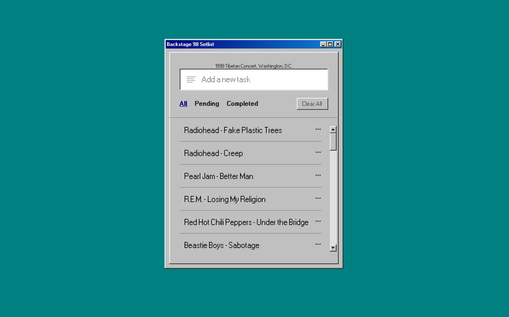
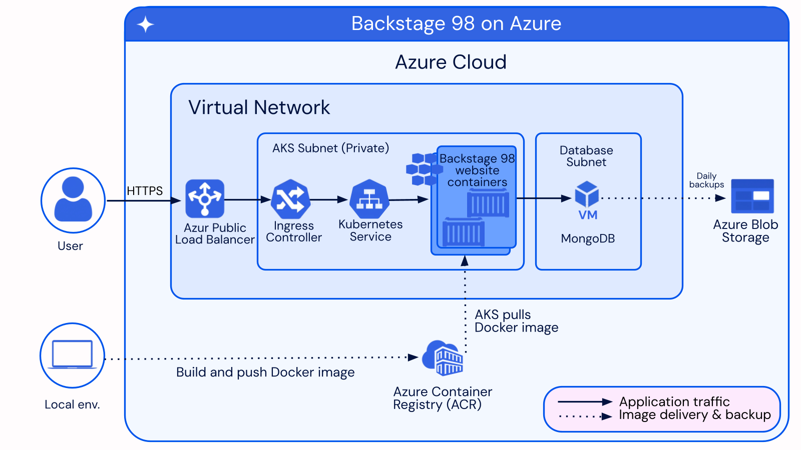

# Backstage 98

A Windows 98-inspired setlist app I adapted from [Tasky](https://github.com/jeffthorne/tasky). Bands and their teams can sign in, add songs, and update a setlist. The application stores its data in MongoDB.



## The story behind the project

I built Backstage 98 as a hands-on cloud exercise: take an existing app, make it my own, and learn how to deploy and secure its infrastructure. The Windows 98 design was inspired by exploring older operating systems with my son.



**[Read the case study](docs/case-study.md)** for the architecture, decisions, security checks, and lessons behind the project.

## What this project demonstrates

- **Application customization:** Adapted a Go to-do app into a setlist experience, including its interface and visual design.
- **Containers:** Built a Docker image for the app and ran it alongside MongoDB.
- **Cloud architecture:** Deployed the app to Azure Kubernetes Service (AKS), connected it to MongoDB on a separate virtual machine, and exposed the site through Kubernetes Ingress and an Azure load balancer.
- **Security and operations:** Configured a network rule restricting MongoDB access, tested an Azure Monitor alert for network-rule changes, and reviewed Azure Policy findings. The interview lab also contained intentionally insecure settings to investigate.
- **Automation:** Added a GitHub Actions workflow to build the image when code is pushed. Automated infrastructure and deployment were planned next steps.

The Azure environment and its intentionally insecure settings are **not** included in this repository. The local setup below is a demonstration, not a production deployment.

## Run the demo locally

You need [Docker Desktop](https://www.docker.com/products/docker-desktop/) with Docker Compose.

```bash
docker compose up --build
```

Open [http://localhost:8080](http://localhost:8080), create an account, and add a song. MongoDB data is stored in a local Docker volume.

To stop the containers:

```bash
docker compose down
```

To also delete the local demo database, run `docker compose down -v`.

## How it works

The Go application serves the website and connects to MongoDB using the `MONGODB_URI` environment variable. `SECRET_KEY` is used to sign authentication tokens. Docker Compose supplies both variables for the local demo.

The local database and demo signing key are for local development only. Use proper secret management, authentication, and supported software versions for a real deployment.

## Background and credits

This is a personal adaptation of [Tasky by Jeff Thorne](https://github.com/jeffthorne/tasky), which credits the [original Go/MongoDB to-do project](https://github.com/dogukanozdemir/golang-todo-mongodb). The original project describes its license as MIT.
