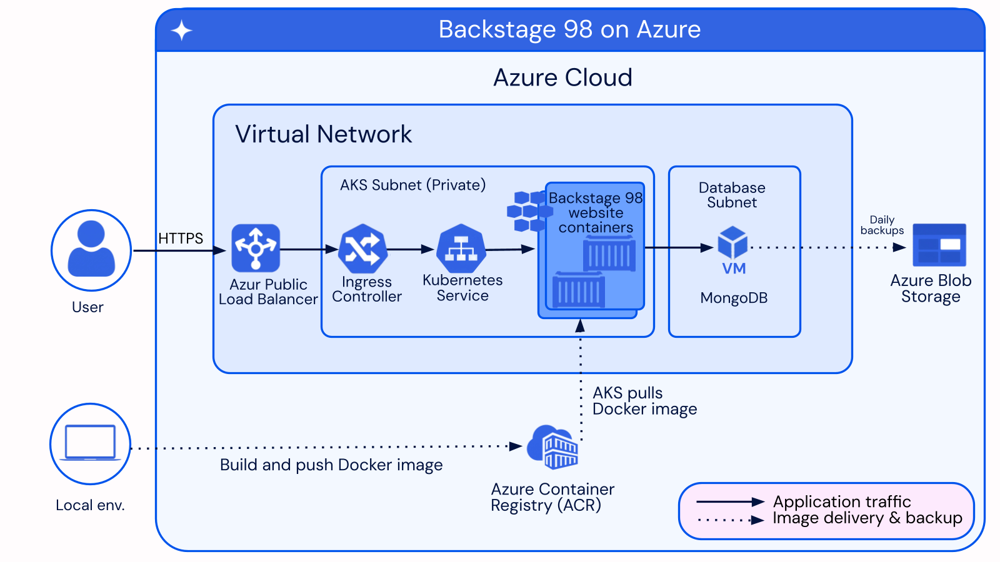

# Backstage 98: from an app to a cloud environment

## Why I built it

I wanted to understand how the pieces of a cloud application fit together, not just read about them. For a technical exercise, I adapted the Tasky to-do app into a setlist website and deployed it on Azure. My son and I enjoy exploring old operating systems, so I gave the project a Windows 98-inspired interface.

The exercise combined an application, infrastructure, and cloud security. It was my first time building an environment like this, so I set it up manually to understand each step.

## Architecture

1. A visitor reaches the website over HTTPS through an Azure load balancer, Kubernetes ingress controller, and service.
2. Azure Kubernetes Service (AKS) runs 2 replicas of the website. It pulls the application image from Azure Container Registry.
3. The app reads and writes data in MongoDB on a separate virtual machine. AKS and the database VM use separate subnets in the same virtual network.
4. A scheduled backup job saves MongoDB backups to Azure Blob Storage.

This diagram describes the Azure lab I built. The repository's Docker Compose setup is a separate local version for exploring the app.

## Decisions and challenges

### Getting the app and database talking

I built the Docker image and deployed the app to AKS, then connected it to the MongoDB VM through a database connection configured as an environment variable. I used network security rules to allow the AKS subnet to reach the MongoDB port and deny other sources. A connection attempt from my Mac timed out; I also verified that the website could save data in MongoDB.

### Understanding security tradeoffs

The exercise deliberately required insecure settings, including public backups and broad permissions. I reviewed the impact rather than treating those settings as production recommendations. Azure Policy flagged the backup storage account's public-access setting. I also tested an Azure Monitor alert by changing a network security rule: Azure recorded the change, the alert fired, and I received an email.

The alert detects changes to network rules; it does not by itself identify every existing misconfiguration. In a real environment, I would make backups private, restrict SSH, and reduce the permissions granted to the VM and website identity.

### Learning when to automate

I used the Azure portal and command-line tools to build the environment manually. That helped me understand the components and their connections. I also added a GitHub Actions workflow that builds the Docker image when code is pushed.

The workflow builds the image; deployment to Azure was still manual. Given more time, I would add infrastructure as code, automate deployment, and introduce security checks.

## What I learned

- Follow the data: tracing a request from the browser through Kubernetes to the database made the architecture easier to understand.
- Separate a security setting from its impact: a public backup, broad identity permissions, and a network rule each expose or protect something different.
- Verify what a test actually shows: a timeout shows that a connection failed; the configured rules provide context about the intended restriction.
- Make the next step explicit: document what works today and what still needs automation or tighter controls.

## Tools

Azure portal and Azure CLI · AKS and kubectl · Azure Container Registry · Azure Blob Storage · Azure Monitor and Azure Policy · Docker · MongoDB · GitHub Actions
